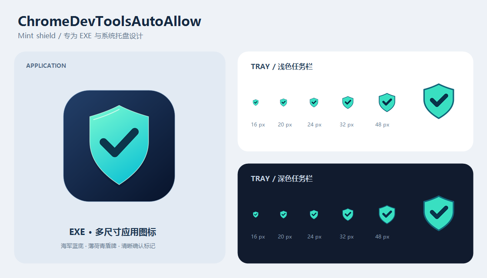

<p align="center"></p>

# ChromeDevToolsAutoAllow

**Windows 上的 Chrome 远程调试授权辅助工具。事件驱动、托盘常驻、默认仅检测。**

[English](docs/README.en.md) · [使用说明](docs/USER_GUIDE.md) · [构建与测试](docs/DEVELOPMENT.md) · [安全边界](SECURITY.md) · [更新记录](CHANGELOG.md)

> **安全提示**：启用自动允许会批准匹配的 Chrome 远程调试请求，可能授予浏览器会话和页面的访问能力。弹窗不提供可验证的请求者身份，本工具**不能保证请求来自 Chrome DevTools MCP**。请仅在你控制、信任的开发环境中使用。
>
> 默认不自动点击；没有开机自启、服务、提权或 Chrome 配置修改。此项目不隶属于 Google 或 Chrome DevTools MCP。

## 为什么做这个工具？

这个项目起源于一个实际的开发场景：**在自己的 Windows 开发电脑上，使用 Chrome DevTools MCP 连接已经打开的 Chrome，继续检查页面和调试问题。**

在连接现有浏览器会话的 `--autoConnect` 流程中，Chrome 会弹出远程调试授权窗口，要求用户点击“允许 / Allow”。这是一项安全确认，并不代表 MCP 配置出错。但在反复联调、重新建立连接时，切回 Chrome 手动确认就成了重复操作；如果没有注意到弹窗，任务也可能一直停在等待授权这一步。

**ChromeDevToolsAutoAllow 要减少的，就是这一步重复的人工确认，而不是替代 Chrome DevTools MCP。** 它是一个独立的 C# 托盘程序：默认只观察；用户明确开启自动模式后，才尝试处理匹配的 Chrome 原生授权窗口。不需要修改 Chrome，也不会替你配置或启动 MCP 服务。

这里针对的是 Chrome 的原生远程调试授权，**不是网页内的登录、Cookie 提示或网站权限弹窗**。背景可参考 [Chrome 官方的现有浏览器会话连接说明](https://developer.chrome.com/blog/chrome-devtools-mcp-debug-your-browser-session)；并非所有 MCP 连接方式或每次工具调用都会走这套授权流程。

## 解决了什么问题？

| 遇到的情况 | 本工具提供的处理方式 |
| --- | --- |
| 连接停在授权窗口，需要切回 Chrome 点“允许” | 程序运行且用户启用自动模式时，识别匹配窗口并尝试调用允许按钮，减少手动切换。 |
| 有时只调试一会儿，有时需要多次连接 | 提供临时 10 分钟和保存选择的永久模式，可从托盘立即停止。永久模式不等于开机自启，也不会在程序退出后继续工作。 |
| 不清楚工具有没有识别窗口、操作后是否有结果 | 提供托盘状态和日志；调用后进行有限的只读检查，结果无法确认时停止自动模式，交由用户处理，而不是反复点击。 |

适合**由你控制、且你愿意为其远程调试请求授权的本机开发环境**。它不是通用弹窗点击器，也不能解决 MCP 安装、配置、网络或连接协议问题。尤其要注意：**识别到 Chrome 授权窗口，不等于验证了请求者身份；窗口关闭，也不等于 MCP 已连接成功。** 如果必须逐次确认是谁在请求访问，应保持仅检测模式并手动授权。

## 功能

- `SetWinEventHook` 事件监听，专用 MTA 线程读取 Windows UI Automation；没有常驻定时窗口扫描。
- 校验目标 Chrome 路径、原生窗口类、中英文标题、提示文本及按钮；不遍历网页 Document。
- 仅检测 / 临时 10 分钟 / 用户确认后保存的永久模式。
- 同一按钮按进程与 UIA RuntimeId 去重，不做重复输入或鼠标、键盘兜底。
- 一次调用后的有限只读检查；结果未确认时停止自动允许，提示手动处理。
- 托盘状态、日志、设置持久化、原创多尺寸 EXE / 托盘图标。



## 下载与运行

从本仓库的 **Releases** 页面下载 `ChromeDevToolsAutoAllow-v1.0.0-windows-x64.zip`，解压到可写目录，运行 `ChromeDevToolsAutoAllow.exe`。

- 目标环境：Windows x64、.NET Framework 4.8、桌面版 Google Chrome。
- 发布包不含个人 `settings.ini`，首次启动保持仅检测。
- 日志与设置写入 EXE 所在目录；不能写入时程序会报错或保持关闭状态。
- EXE 图标已经内嵌，运行不依赖外部图标或 NuGet 包。
- 如果旧版 ChromeConsentGuard 正在运行，请先从旧版托盘退出。两者共用单实例锁，避免重复操作。

## 从源码构建

在 Windows PowerShell 中，从仓库根目录运行：

```powershell
.\scripts\build.ps1
.\scripts\test.ps1 -UnitOnly
.\scripts\test.ps1
```

产物位于 `outputs/build/`。脚本使用系统 .NET Framework 的 C# 编译器，不需要 .NET SDK；IDE 构建可打开 `ChromeDevToolsAutoAllow.sln`，需要 .NET Framework 4.8 开发工具。

完整测试会短暂创建本项目的模拟窗体，**不会点击真实 Chrome 授权**。CI 只运行不需要交互桌面的单元检查。

## 验证状态与限制

- 首发基于旧项目 ChromeConsentGuard v1.2.1，重新命名为独立项目 **v1.0.0**，不表示功能回退。
- 项目拆分后，本机单元检查 **72 项**、完整模拟集成检查 **128 项**通过；后者已包含前者。
- 前身版本的一次真实联调记录到调用返回、弹窗消失及 MCP 连接成功，但这**不是长期稳定性、其他 Chrome 版本或其他系统的保证**。
- `INVOKE_RETURNED` 不代表授权成功；`DIALOG_DISMISSED` 不代表 MCP 已连接。
- UIA 提供方可能阻塞，有限等待不是外部调用的硬超时。原生 UI、语言或 Chrome 版本变化可能导致识别失败。
- 永久模式仍受单次运行 256 次尝试的保护上限约束；退出不撤销 Chrome 已有的调试连接。

## 仓库结构

```text
src/ChromeDevToolsAutoAllow/       应用源码与项目文件
tests/ChromeDevToolsAutoAllow.Tests/ 独立测试程序与模拟窗体
assets/                          图标、SVG、PNG 预览
tools/                           原创图标生成器
scripts/                         构建、测试、图标与打包脚本
docs/                            使用说明、开发说明、发布说明
.github/                         CI、标签发布与问题模板
outputs/                         本地产物（忽略，不提交）
work/                            本地临时文件与历史归档（忽略，不提交）
```

## 发布

`scripts/release.ps1 -IncludeSource` 生成 Windows ZIP、干净 Git 提交的源码 ZIP 和 SHA-256 清单。推送与 `VERSION` 一致的 `v*` 标签会触发 GitHub 发布工作流；仓库建立与首次推送需要有权限的 GitHub 账号。

详见 [发布流程](docs/RELEASING.md)。许可证为 [MIT](LICENSE)；图标为本项目原创资源。
